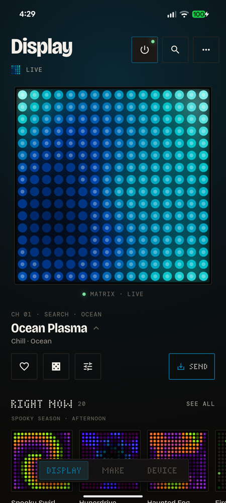
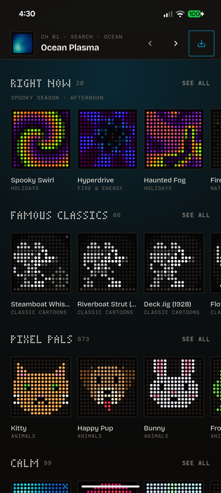
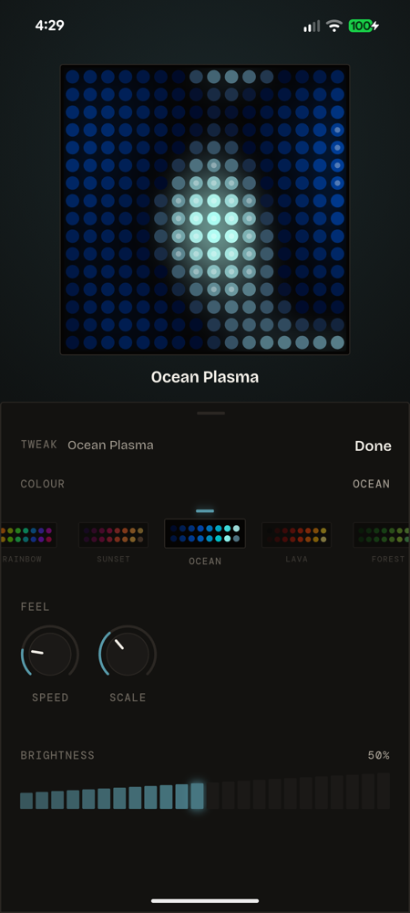
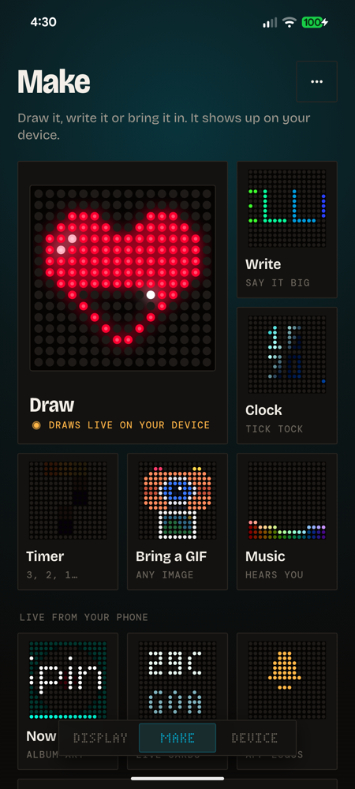
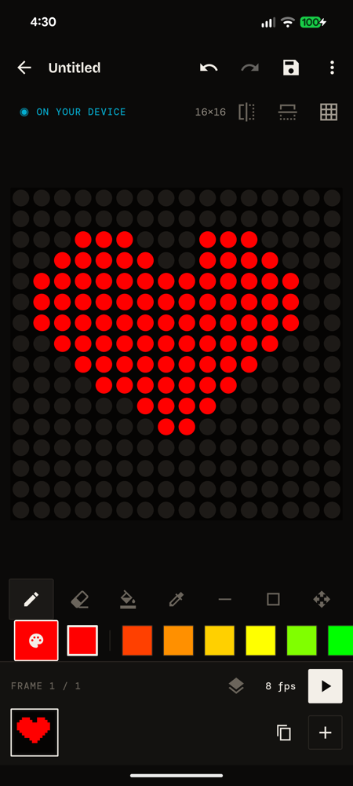
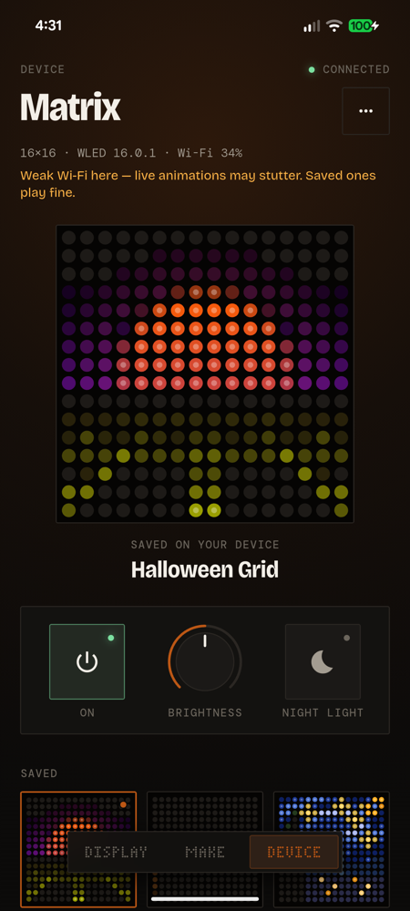
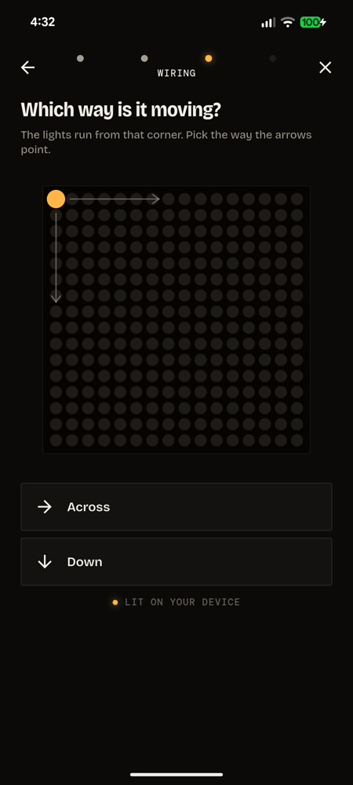
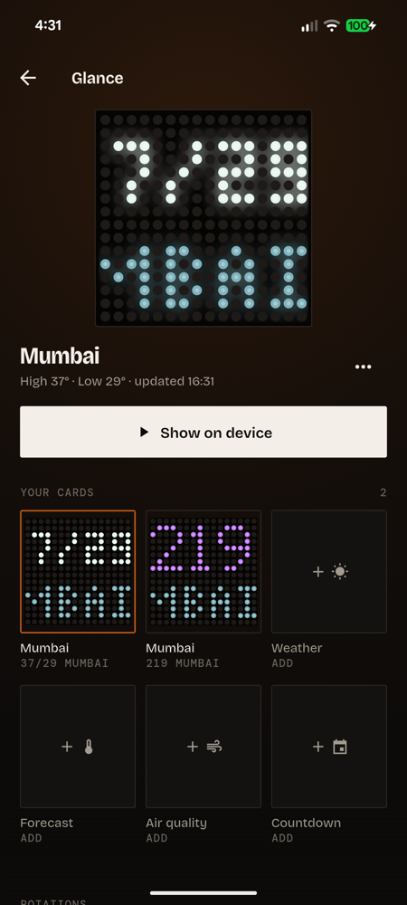
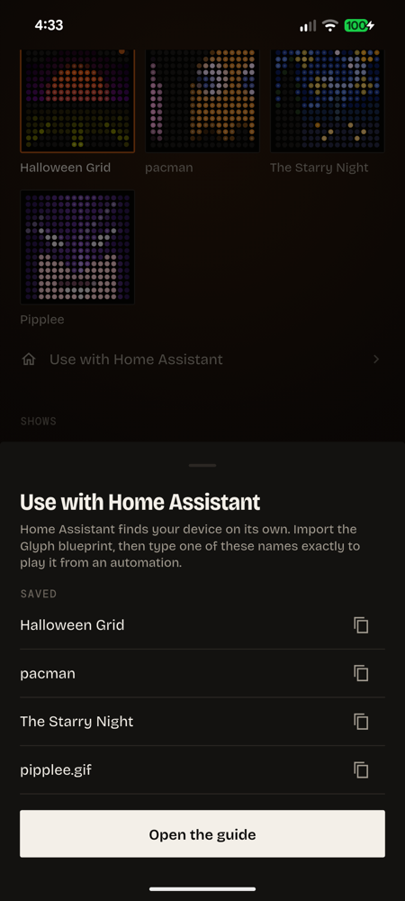

<p align="center">
  
</p>

<h1 align="center">Glyph</h1>

<p align="center">
  <b>Your matrix, alive.</b><br>
  Set up your WLED matrix in three taps, then fill it with 1,200+
  original animations. Draw, write, play games and put your music on the wall.
  Free, open source, no account.
</p>

<!-- Clip A (20 s: swipe channels, Send, phone off, panel keeps playing) replaces intro.gif here once filmed. Original/CC0 art only. -->
<p align="center">
  
</p>

<p align="center">
  <a href="https://github.com/spandan-kumar/glyph/releases/latest"><b>⬇ Download the latest APK</b></a>
  ·
  <a href="https://apps.obtainium.imranr.dev/redirect?r=obtainium://add/https://github.com/spandan-kumar/glyph">Get updates with Obtainium</a>
</p>

<p align="center">
  Android 7+ · 64-bit ARM · a WLED matrix on your Wi-Fi<br>
  <b>No device yet?</b> You can still browse, draw and play.
</p>

<p align="center">
  <a href="https://github.com/spandan-kumar/glyph/releases/latest"></a>
  <a href="LICENSE"></a>
  <a href="https://github.com/spandan-kumar/glyph/actions/workflows/ci.yml"></a>
  <a href="https://discord.gg/fMbzGQd6wk"></a>
</p>

Glyph renders everything on your phone and either **streams** it to the
matrix live or **sends** it onto the matrix so it keeps playing without the
phone. Live streaming works on any WLED build that accepts DDP, even one with
little memory; see [What you need](#what-you-need) for what has been tested.

## Screenshots

| Display | Channels | Tweak |
|:---:|:---:|:---:|
|  |  |  |
| **Make** | **Draw** | **Device** |
|  |  |  |
| **Set up** | **Glance** | **Home Assistant** |
|  |  |  |

## Features

**Set up** (Device → **Set up display**) — get a new display working without
touching WLED's settings pages. The wizard:

- joins a new WLED device to your home Wi-Fi (assisted connect on Android,
  guided Wi-Fi settings otherwise) and reads what it is;
- offers size presets, then a **three-tap light test** that finds the wiring
  (start corner, run direction, zig-zag);
- handles **grids of panels**: panel order, upside-down panels, plus power
  and frame-rate tips;
- writes the layout into WLED's own config, so saved GIFs, WLED effects and
  live streams all come out the right way up;
- finishes with a visual check, and **undo** puts the old settings back.

WLED must already be installed on the controller
([install.wled.me](https://install.wled.me)). Complex setups, such as several
outputs or custom LED maps, keep their existing configuration. Devices also
set their own clock (internet time with your phone's time zone, and your
phone's clock straight away), so Routines run on time.

**Display** — your matrix lives at the top of the screen as a glowing live
panel. Swipe it to flip through animations like TV channels, roll the dice
for a surprise, and tap **Send** to put an animation on the device. Tweak
colours and motion with a palette reel and rotary knobs; the whole app glows
with whatever is on your matrix.

- **1,236 animations** in subject groups (Animals, Nature, Holidays, Gaming,
  Flags, Patterns and more): 62 procedural effects (plasma, fire, aurora,
  reaction–diffusion, falling sand…), 356 original and CC0 pixel-art sprites,
  **Famous Classics** — public-domain characters and paintings such as
  Pinocchio, Alice, Dracula and The Starry Night.
- Search the whole library by name, subject, colour or native size. Everything
  is bundled, so it works offline.
- Seamless loops on the device, accurate colours (device gamma, true blacks,
  stable hues at low brightness).

**Make**
- **Draw** — frames, onion skin, mirror drawing, fill, shapes and undo, or
  start from a picture or GIF; your strokes appear on the matrix as you draw.
- **Write**, **Clock** and **Timer** — hand-made pixel fonts; clocks keep the
  real time on the device with your phone off.
- **Bring a GIF** — any GIF, WebP or photo, cropped and tuned for LEDs.
- **Music** — nine visualisers driven by the microphone, with beat detection.
  Audio never leaves the phone.
- **Now Playing** — the cover of whatever your phone is playing (Spotify,
  YouTube Music, any player) with a progress bar, live on the matrix. Covers
  are never stored on the phone or the device.
- **Play** — Snake, Blocks, Brick Breaker, Pong, Flap, Racer and Invaders,
  with your phone as the controller.

**Device**
- Power, brightness and night light; **Saved** animations, **Shows**
  (playlists) and **Routines** (schedules) that run without your phone.
- **Home Assistant**: blueprints show a Saved look or Show when something
  happens, timed or until cleared, with quiet hours, and go back afterwards;
  open **Use with Home Assistant** in the app, or see
  [docs/HOME_ASSISTANT.md](docs/HOME_ASSISTANT.md).
- **Glance** cards for weather, forecast, air quality and day counters (Open-Meteo,
  CAMS); see [docs/GLANCE.md](docs/GLANCE.md).
- The **Glyph intro** plays every time your device powers on.
- Storage alerts, multiple devices, a home-screen widget, and the full WLED
  settings inside the app.

## Install

1. On your Android phone (7.0+, 64-bit ARM), open the
   [latest release](https://github.com/spandan-kumar/glyph/releases/latest)
   and download the file ending in `.apk`.
2. Open it from your notifications or Downloads.
3. If Android asks, allow installs from this source (your browser or file
   manager), go back and tap **Install**.

The `.sha256` file and the source archives on the release page aren't
installers. Glyph isn't on the Play Store yet. To get updates automatically, add it to
[Obtainium](https://apps.obtainium.imranr.dev/redirect?r=obtainium://add/https://github.com/spandan-kumar/glyph).
Each release lists the APK's SHA-256 next to it.

## What you need

- A WLED controller driving an LED matrix, with WLED already installed
  ([install.wled.me](https://install.wled.me)); Glyph's setup wizard
  configures the matrix layout for you
- An Android phone (7.0+, 64-bit ARM) on the same Wi-Fi

| Controller | Live streaming | Send to device |
|---|:---:|:---:|
| ESP32 / S2 / S3 / C3 on WLED 16+ | ✅ | ✅ |
| ESP32 on WLED 0.14–0.15 | ✅ | — built-in effects only |
| ESP8266 | ✅ | — no GIF player in WLED |

Glyph checks each controller when it connects and only offers what works.

**What has been tried on real hardware.** Glyph is a one-person project, so
here is exactly what has been checked and what hasn't:

| | Hardware and setups |
|---|---|
| ✅ **Tested** | 16×16 WS2812B panel on an ESP32 running WLED 16.0.1: streaming, Send and Saved, Now Playing, Glance, the seven games, and the setup wizard on an already-configured device |
| 🟡 **Expected to work** (built to WLED's source, covered by automated tests) | Other single-panel sizes (8×8, 32×8, 32×32, 64×32…), SK6812 panels, HUB75 panels on WLED's ESP32_HUB75 builds, ESP32-S2/S3/C3, ESP8266 for streaming |
| ⚪ **Not yet tested on hardware** | The wizard on a never-configured controller, grids of several physical panels, the Home Assistant blueprints against a live Home Assistant, iOS |

If you try one of the untested setups, please tell us what happened in
[Discord](https://discord.gg/fMbzGQd6wk) or an
[issue](https://github.com/spandan-kumar/glyph/issues/new/choose).

## How it works

```
 Phone: render engine ──┬── Stream: DDP over UDP :4048, 40 fps ──────┐
 (one engine draws the  │                                            ├─► WLED ─► LEDs
  previews and the      └── Send: bake GIF → POST /upload →          │
  real LEDs)                Image effect → preset ───────────────────┘
```

- **Streaming** sends each frame with [DDP](https://kno.wled.ge/interfaces/ddp/),
  colour-corrected for the device.
- **Sending** bakes a seamless-looping GIF (shared palette, delta frames,
  typically 8–30 KB at 16×16), uploads it, verifies it and saves a WLED
  preset — the device keeps showing the animation live until the file is safe.
- The library is data: an effect id plus parameters and a palette, or a
  sprite, so new items can ship as a catalog file.

## Privacy and security

No account, no cloud, no ads, no tracking: Glyph talks to the devices on your
Wi-Fi, and drawings and audio stay on your phone. Details, including the few
optional internet lookups, are in [docs/PRIVACY.md](docs/PRIVACY.md).
To report a vulnerability, see [SECURITY.md](SECURITY.md).

## Build from source

Requires Flutter 3.47+ (Dart 3.13) and the Android SDK.

```bash
flutter pub get
flutter test
flutter run
flutter build apk --release --split-per-abi --target-platform android-arm64
```

See [AGENTS.md](AGENTS.md) for the project layout, conventions, tools and how
to test against a real device, [docs/design/UX.md](docs/design/UX.md) for
the design language, and [CONTRIBUTING.md](CONTRIBUTING.md) to add an
animation or send a pull request. Glyph's code is released under the
[MIT License](LICENSE).

## Community

- **Chat** — the [Glyph Discord](https://discord.gg/fMbzGQd6wk): help, ideas, beta builds
- **Questions and help** — [Discussions](https://github.com/spandan-kumar/glyph/discussions)
- **Show your setup** — photos and clips of your matrix in
  [Discord’s #show-your-setup](https://discord.gg/fMbzGQd6wk)
- **Bugs, animation and display requests** — use **Send feedback** in the
  app, or the [issue forms](https://github.com/spandan-kumar/glyph/issues/new/choose);
  👍 the requests you want most
- **What's next** — the [roadmap board](https://github.com/users/spandan-kumar/projects/4) (plan: [docs/ROADMAP.md](docs/ROADMAP.md))
- **Contribute** — draw a sprite in a few minutes, see
  [CONTRIBUTING.md](CONTRIBUTING.md); everyone follows the
  [Code of Conduct](CODE_OF_CONDUCT.md)
- **Let your AI agent draw one** — the
  [glyph-animation skill](skills/README.md) helps Claude Code, Codex, Cursor
  and other agents draw a sprite and open the pull request

## Content and credits

Effects and the sprite packs are original to this project or CC0 with
credits; Famous Classics are drawn from public-domain originals and carry
their source notes. No code was copied from WLED or other GPL/EUPL projects.
Fonts: Bricolage Grotesque and DM Mono (SIL OFL).

The code and original artwork are released under the [MIT License](LICENSE).
Everything in the library is original, CC0 or public domain.

Glyph is not affiliated with the WLED project.
